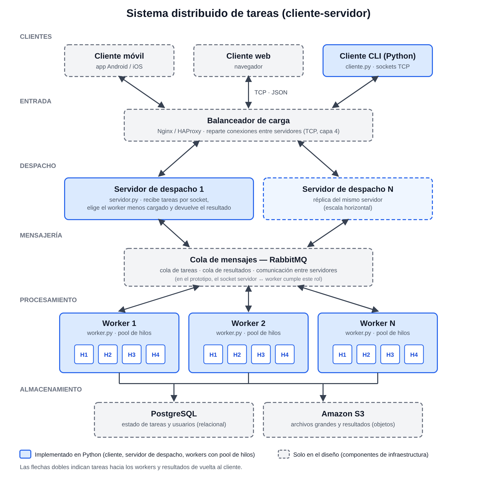

# PFO 3: Rediseño como Sistema Distribuido (Cliente-Servidor)

Sistema distribuido en Python, con **sockets TCP** y sin librerías externas: un cliente envía tareas a un servidor de despacho, que las reparte entre varios *workers* (cada uno con su pool de hilos) y devuelve los resultados.

## 1. Diagrama del sistema



Versión vectorial: [`docs/diagrama.svg`](docs/diagrama.svg).

| Componente (diagrama) | Rol | ¿Implementado? |
| --- | --- | --- |
| Clientes (móvil, web, CLI) | Envían tareas y reciben resultados | CLI en Python (`cliente.py`). Móvil y web hablarían el mismo protocolo. |
| Balanceador de carga (Nginx / HAProxy) | Reparte las conexiones entre varios servidores de despacho | Solo diseño |
| Servidor de despacho | Recibe tareas por socket, elige worker, devuelve el resultado | Sí (`servidor.py`) |
| Cola de mensajes (RabbitMQ) | Desacopla servidores y workers, comunica servidores entre sí | Solo diseño. En el prototipo la conexión por socket servidor ↔ worker cumple ese rol. |
| Workers con pool de hilos | Ejecutan las tareas en paralelo | Sí (`worker.py`, `ThreadPoolExecutor`) |
| Almacenamiento (PostgreSQL, S3) | Estado de tareas/usuarios y archivos grandes | Solo diseño |

## 2. Cómo funciona

```
cliente ──(9000)──► servidor ──(9001)──► worker 1 (pool de 4 hilos)
                       │       └───────► worker 2 (pool de 4 hilos)
                       └───────────────► worker N ...
        ◄── resultado ◄──────────────── (vuelve por el mismo camino)
```

1. Los **workers** se conectan al puerto 9001 y se registran con su nombre y tamaño de pool.
2. El **cliente** se conecta al puerto 9000 y envía tareas sin esperar la respuesta anterior.
3. El **servidor** asigna cada tarea al worker con menor carga relativa (`tareas pendientes / hilos`).
4. El **worker** la ejecuta en un hilo de su pool y devuelve el resultado.
5. El servidor reenvía el resultado al cliente que lo pidió. Los resultados pueden llegar en distinto orden que los envíos, por eso cada tarea lleva un `id`.

### Protocolo

Mensajes JSON, uno por línea (TCP no delimita mensajes, así que se usa `\n` como separador).

```json
// cliente -> servidor
{"id": 1, "tipo": "fibonacci", "datos": 30}
// servidor -> cliente
{"id": 1, "ok": true, "resultado": 832040, "worker": "worker-2"}
{"id": 2, "ok": false, "error": "no hay workers disponibles"}
// worker -> servidor (registro)
{"rol": "worker", "nombre": "worker-1", "hilos": 4}
```

Tareas disponibles: `fibonacci`, `es_primo`, `invertir_texto`, `dormir` (simula una tarea de E/S lenta). Son una lista blanca: el cliente nunca puede ejecutar código arbitrario en el worker. El comando especial `estado` devuelve los workers conectados y su carga.

### Decisiones de diseño

- **Menos cargado primero** en lugar de *round-robin*: reparte mejor cuando las tareas duran distinto.
- **Tolerancia a fallos:** si un worker se desconecta, sus tareas en curso se reasignan a otro (hasta 3 intentos). Es una entrega "al menos una vez": una tarea podría ejecutarse dos veces, por eso conviene que sean idempotentes.
- **Pool de hilos y el GIL:** los hilos aprovechan bien las tareas de E/S (`dormir`), pero las tareas que usan CPU (`fibonacci`, `es_primo`) no se paralelizan dentro de un mismo proceso Python por el GIL. En un sistema real se escalaría con más workers (procesos o máquinas), que es justamente lo que permite esta arquitectura.
- **Seguridad:** el límite de 1 MB por mensaje y las validaciones evitan que un cliente defectuoso tumbe el servidor. Sin TLS ni autenticación: en producción irían detrás del balanceador con TLS.

## 3. Cómo ejecutarlo

Requiere Python 3.9 o superior. No hay que instalar nada. Todos los comandos se ejecutan desde la raíz del repositorio.

**Opción rápida (todo en un comando, ideal para las capturas):**

```bash
python demo.py            # 12 tareas repartidas entre 3 workers
python demo.py --falla    # un worker se cae a mitad y sus tareas se reasignan
```

**Opción completa (una terminal por componente, como en un despliegue real):**

```bash
python -m distribuido.servidor                              # terminal 1
python -m distribuido.worker --nombre worker-1 --hilos 4    # terminal 2
python -m distribuido.worker --nombre worker-2 --hilos 4    # terminal 3
python -m distribuido.cliente                               # terminal 4 (menú interactivo)
python -m distribuido.cliente --lote 20                     # o: envía 20 tareas y sale
```

Para usar varias máquinas: arrancá el servidor con `--host 0.0.0.0` y en los workers/clientes pasá `--host IP_DEL_SERVIDOR`.

### Pruebas automáticas

```bash
python -m unittest -v
```

Cubren los resultados de las tareas, la validación de entradas, el reparto entre workers, el paralelismo del pool, los mensajes inválidos y la reasignación cuando un worker se cae.

## 4. Estructura

```
├── distribuido/
│   ├── comun.py       # protocolo: JSON por línea sobre TCP
│   ├── tareas.py      # tareas que saben ejecutar los workers
│   ├── servidor.py    # servidor de despacho (reparto y reasignación)
│   ├── worker.py      # worker con pool de hilos
│   └── cliente.py     # cliente de consola
├── tests/test_sistema.py
├── docs/diagrama.svg · diagrama.png
├── demo.py
└── README.md
```

## 5. Evidencias

Capturas de la ejecución en [`docs/capturas/`](docs/capturas/): servidor con workers conectados, cliente enviando un lote, y la reasignación de tareas con `python demo.py --falla`.
